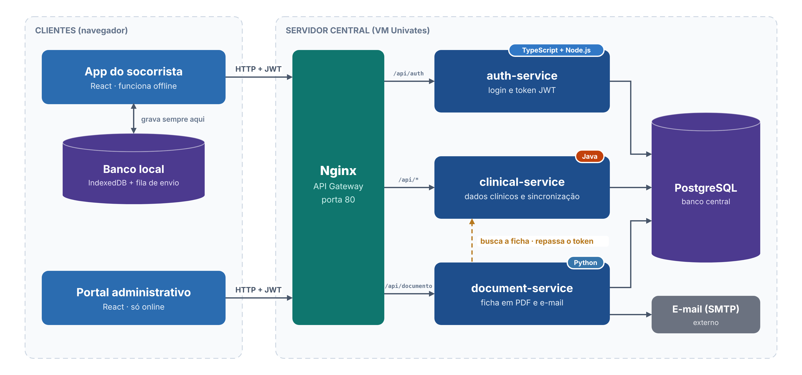

# MedicalField

**Prontuário eletrônico de emergência para atendimento pré-hospitalar, que funciona sem sinal.**

A equipe registra paciente, sinais vitais, Glasgow, Manchester e medicamentos **com ou sem internet**. Os registros ficam no aparelho e sobem para o servidor central quando a conexão volta, sem duplicar e sem perder alterações concorrentes. A central acompanha tudo pelo portal, gera a ficha em **PDF** e a envia por **e-mail** ao paciente ou familiar.



## Componentes

| Componente | Tecnologia | Pasta |
|---|---|---|
| auth-service | Node.js 22 + TypeScript (Express, JWT, bcrypt) | `services/auth-service` |
| clinical-service | Java 21 (HttpServer do JDK, JDBC, Jackson) | `services/clinical-service` |
| document-service | Python 3 + FastAPI (ReportLab, SMTP) | `services/document-service` |
| Banco central | PostgreSQL | `database/` |
| App da equipe (PWA, offline) | React + Vite, IndexedDB (Dexie) | `client-app/` |
| Portal administrativo | React + Vite | `admin-portal/` |
| API Gateway | Nginx | `deploy/nginx/` |

## Como rodar

**Servidor Ubuntu** (em produção na VM da Univates: `http://177.44.248.79/admin/` e `/app/`):
```bash
sudo bash scripts/install_vm.sh             # dependências, build, Nginx e systemd
sudo bash scripts/install_vm.sh --reset-db  # também recria o banco com os dados de exemplo
```

**Desenvolvimento local** (PostgreSQL com o banco `medicalfield` carregado de `database/01_schema.sql` e `02_seed.sql`):
```bash
./scripts/dev-start.sh                          # sobe os 3 serviços (logs em ./logs)
cd client-app && npm install && npm run dev     # http://localhost:5173/app/
cd admin-portal && npm install && npm run dev   # http://localhost:5174/admin/
```

**Testes:** `npm run test:e2e` em `client-app/` (fluxo completo), `mvn test` no clinical-service (Strategies) e a coleção Postman (`postman/`, 33 requisições).

### Acessos dos dados de exemplo

| Uso | Tipo | Registro | Senha |
|---|---|---|---|
| Portal administrativo | ADM | `admin` | `senha123` |
| App da equipe | CRM / COREN / SOC | `12345` / `54321` / `SOC-0001` | `senha123` |

## Documentação

| Assunto | Documento |
|---|---|
| Requisitos do enunciado × evidências | [docs/00](docs/00_REQUISITOS_E_EVIDENCIAS.md) |
| Arquitetura e tecnologias | [docs/01](docs/01_ARQUITETURA.md) |
| APIs | [docs/02](docs/02_API.md) · [Swagger / OpenAPI](ferramentas/openapi.yaml) · [Postman](postman/) |
| Bancos de dados | [docs/03](docs/03_BANCO_DE_DADOS.md) |
| Padrões de projeto | [docs/04](docs/04_PADROES_DE_PROJETO.md) |

<sub>Trabalho final de Arquiteturas de Software (Univates, 2026/B).</sub>
