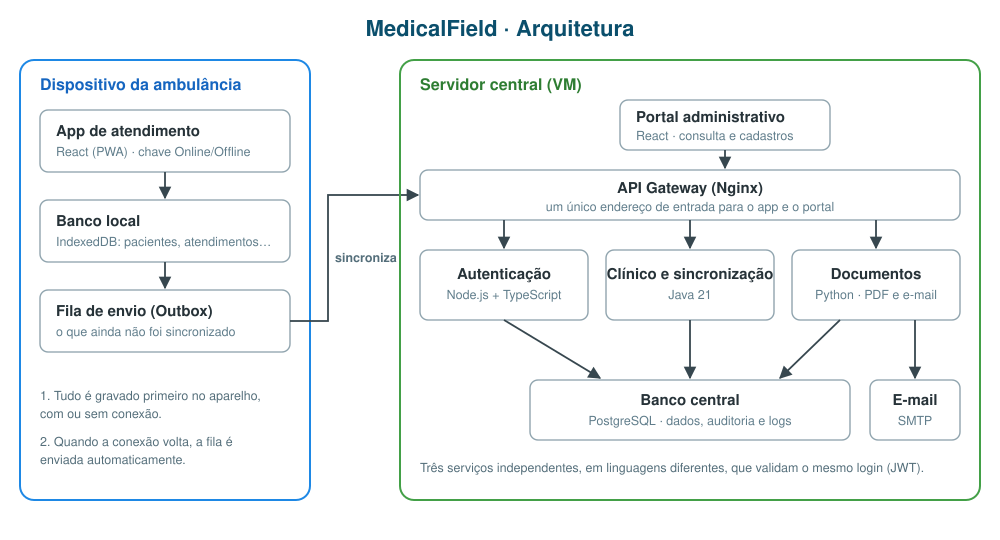
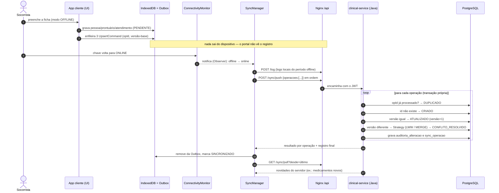

# 1. Modelo de Arquitetura — MedicalField



## 1.1 Visão geral

O MedicalField segue duas ideias centrais:

1. **Offline-first no dispositivo**: toda gravação acontece primeiro no banco local do dispositivo da ambulância. A rede é usada só para *sincronizar*, nunca para *registrar*.
2. **Microsserviços no servidor central**: três serviços autônomos, em três linguagens, atrás de um API Gateway (Nginx), compartilhando um banco PostgreSQL.

| Camada | Componente | Tecnologia | Responsabilidade |
|---|---|---|---|
| Cliente | Aplicação cliente (PWA) | React 18 + Vite 6 (JavaScript) | Ficha de atendimento, chave Online/Offline, sincronização |
| Cliente | Banco local embarcado | IndexedDB via Dexie 4 | Pessoas, prontuários, atendimentos, medicamentos, Outbox, logs offline |
| Cliente | Service Worker | vite-plugin-pwa (Workbox) | Abre o app mesmo sem internet (cache do app) |
| Servidor | API Gateway | Nginx 1.24 | Roteia `/api/*` para os serviços, serve as interfaces, repassa o IP real (`X-Real-IP`), CORS |
| Servidor | **auth-service** | **Node.js 22 + TypeScript** (Express, bcrypt, jsonwebtoken) | Login por CRM/COREN/ID de socorrista, emissão de JWT, cadastro de profissionais |
| Servidor | **clinical-service** | **Java 21** (HttpServer do JDK, JDBC, Jackson) | Pessoa, prontuário, atendimento, medicamentos, sincronização (pull/push), conflitos, auditoria, logs offline |
| Servidor | **document-service** | **Python 3 + FastAPI** (ReportLab, smtplib, httpx) | Ficha de atendimento em PDF e envio por e-mail com anexo |
| Servidor | Banco central | PostgreSQL 14+ | Dados consolidados, idempotência, auditoria e logs de acesso |
| Servidor | Portal administrativo | React 18 + Vite 6 | Login, atendimentos, auditoria, logs e cadastros (pacientes/prontuários, medicamentos, profissionais), com inativação em vez de exclusão |
| Externo | Servidor SMTP | Gmail/Mailtrap/qualquer SMTP | Entrega do e-mail ao paciente ou familiar |

## 1.2 Por que PWA + IndexedDB (decisão de arquitetura)

O enunciado pede um **dispositivo móvel** com **banco local embarcado** e operação local irrestrita. As alternativas avaliadas:

| Opção | Banco local | Prós | Contras |
|---|---|---|---|
| **PWA (escolhida)** | IndexedDB (Dexie) | Roda em qualquer celular/tablet/notebook pelo navegador; instalável; Service Worker abre o app offline; mesma base de código do portal | IndexedDB não é SQL |
| Electron/Tauri | SQLite | SQLite é "mais visível" como banco embarcado | Só desktop; empacotamento e instalação mais trabalhosos |
| App nativo/React Native | SQLite | Experiência móvel nativa | Exige toolchain Android/iOS; curva de aprendizado alta para 1 pessoa em 1 mês |

O **IndexedDB é um banco transacional embarcado no navegador**: fica gravado no próprio dispositivo, sobrevive a reinicializações e funciona sem rede. O Dexie oferece tabelas, índices (inclusive compostos) e transações — o mesmo papel que o SQLite teria.

> **Observação sobre HTTPS:** o Service Worker só é registrado em contexto seguro (HTTPS ou `localhost`). Acessando a VM por `http://IP/app/`, o banco local (IndexedDB), a Outbox e toda a sincronização funcionam normalmente; o que não funciona é **reabrir a página** sem rede. Para demonstrar também isso, rode o cliente no notebook (`npm run preview`, que é `localhost`) apontando para a VM — ver `06_DEPLOY_VM.md`.

## 1.3 Fluxo de sincronização



### Garantias

| Requisito | Como é atendido |
|---|---|
| **Operação local irrestrita** | Toda gravação vai para o IndexedDB primeiro. Com o simulador OFFLINE, `apiClient` recusa qualquer requisição (`OfflineError`). |
| **Envio quando a conexão voltar** | `ConnectivityMonitor` (Observer) notifica o `SyncManager`, que envia a Outbox automaticamente. Também há o botão "Sincronizar". |
| **Idempotência** | (1) IDs são UUID gerados no dispositivo; (2) cada comando tem um `opId` registrado em `sync_operacao` — reenvio devolve `DUPLICADO`; (3) conteúdo idêntico devolve `SEM_ALTERACAO`; (4) itens de medicamento sem id recebem id determinístico. |
| **Tratamento de conflitos** | Controle otimista por `versao`. Divergência → `ConflictStrategy` da entidade: pessoa e atendimento = **LWW** (vence o `atualizadoEm` mais recente); prontuário = **MERGE** (une alergias/comorbidades: nunca perde uma alergia). Configurável por variável de ambiente. |
| **Rastreabilidade** | `auditoria_alteracao` guarda operação, origem (API_DIRETA/SYNC_PUSH/PORTAL), estratégia, profissional, dispositivo, `opId` e o JSON **antes/depois** (no conflito, as duas versões). |
| **Ordem** | A Outbox é FIFO; edições repetidas de um registro ainda não enviado são **coalescidas no mesmo lugar** da fila (pessoa sempre antes do prontuário). |

## 1.4 Segurança e auditoria de acesso

- **Autenticação**: `POST /auth/login` é a única rota pública. O login usa o tipo de registro (CRM, COREN, SOC, ADM) + número + senha (bcrypt). O token JWT HS256 carrega id, nome, tipo, registro e perfil.
- **Validação distribuída**: cada serviço valida o JWT por conta própria, com o segredo compartilhado `JWT_SECRET` (não há chamada ao auth-service a cada requisição).
- **Autorização**: as consultas `GET /log`, `GET /auditoria` e `GET /auth/profissional` exigem perfil `ADMIN`. O `POST /log` (envio dos logs offline) aceita qualquer profissional autenticado.
- **Logs de acesso** (middleware/interceptor em cada serviço): data/hora, IP do cliente (`X-Real-IP` do Nginx), profissional autenticado, método, rota, status e tempo em ms. Vão para o console (journalctl) e para a tabela `log_acesso`. O filtro de log é o **primeiro** da cadeia, então registra inclusive requisições recusadas (401).
- **LGPD**: a ficha em PDF e o e-mail informam que contêm dado pessoal sensível de saúde.

## 1.5 Comunicação entre microsserviços

O **document-service não acessa as tabelas clínicas**: ele busca a ficha no clinical-service por HTTP (`GET /atendimento/detalhe/{id}`), repassando o token do profissional. Assim, quem pede o PDF precisa ter permissão para ver o atendimento, e cada serviço mantém a responsabilidade sobre os seus dados (ele só escreve na tabela comum `log_acesso`).

## 1.6 Implantação na VM

Tudo roda na mesma VM (Ubuntu), sem contêineres:

| Processo | Como roda | Porta | Exposto para fora |
|---|---|---|---|
| Nginx (gateway + arquivos das interfaces) | serviço do sistema | 80 | Sim |
| auth-service | systemd `medicalfield-auth` (Node.js) | 3001 | Não, só via `/api/auth/` |
| clinical-service | systemd `medicalfield-clinical` (`java -jar`) | 8080 | Não, só via `/api/` |
| document-service | systemd `medicalfield-document` (uvicorn) | 8000 | Não, só via `/api/documento/` |
| PostgreSQL | serviço do sistema | 5432 | Não |

Caminhos publicados pelo Nginx: `/admin/` (portal), `/app/` (cliente) e `/api/...` (microsserviços). O código fica em `/opt/medicalfield`, a configuração em `/opt/medicalfield/.env` e as interfaces compiladas em `/var/www/medicalfield`. Passo a passo em [06_DEPLOY_VM.md](06_DEPLOY_VM.md).

## 1.7 Estrutura do repositório

```
medicalfield/
├── database/            01_schema.sql · 02_seed.sql · 03_novos_medicamentos.sql
├── services/
│   ├── auth-service/       Node.js + TypeScript
│   ├── clinical-service/   Java 21 (pom.xml)
│   └── document-service/   Python + FastAPI
├── client-app/          PWA do socorrista (React + Dexie) + tests/e2e.mjs
├── admin-portal/        Portal administrativo (React): ui/ componentes · paginas/ uma tela por menu
├── deploy/              nginx/medicalfield.conf · systemd/*.service
├── scripts/             install_vm.sh · dev-start.sh · dev-stop.sh
├── postman/             MedicalField.postman_collection.json
└── docs/                esta documentação (00 = índice requisito × evidência)
```
