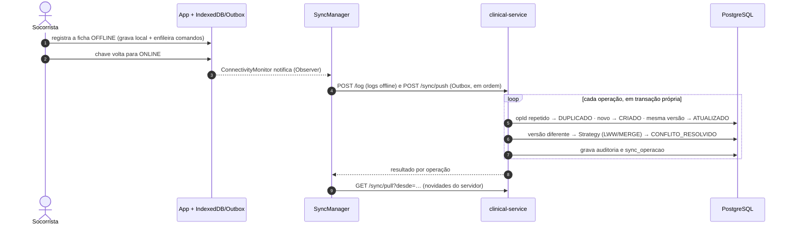

# 1. Modelo de Arquitetura


Duas ideias centrais:

1. **Offline-first:** toda gravação acontece primeiro no banco local do aparelho. A rede serve só para *sincronizar*.
2. **Microsserviços:** três serviços autônomos, em três linguagens, atrás de um API Gateway (Nginx), com um PostgreSQL central.

## 1.1 Componentes e tecnologias

| Camada | Componente | Tecnologia | Responsabilidade |
|---|---|---|---|
| Cliente | App da equipe (PWA) | React 18 + Vite 6 | Ficha de atendimento, chave Online/Offline, sincronização |
| Cliente | Banco local | IndexedDB via Dexie 4 | Dados clínicos, Outbox, logs offline |
| Cliente | Service Worker | vite-plugin-pwa (Workbox) | Abre o app sem internet |
| Servidor | API Gateway | Nginx | Roteia `/api/*`, serve as interfaces, repassa o IP real |
| Servidor | **auth-service** | Node.js 22 + TypeScript | Login (CRM/COREN/SOC/ADM), JWT, cadastro de profissionais |
| Servidor | **clinical-service** | Java 21 (HttpServer do JDK, JDBC) | Pessoa, prontuário, atendimento, medicamentos, sync, conflitos, auditoria |
| Servidor | **document-service** | Python 3 + FastAPI (ReportLab) | Ficha em PDF e envio por e-mail |
| Servidor | Banco central | PostgreSQL | Dados consolidados, idempotência, auditoria, logs |
| Servidor | Portal administrativo | React 18 + Vite 6 | Atendimentos, auditoria, logs e cadastros |
| Externo | SMTP | Gmail | Entrega do e-mail |

**Por que PWA + IndexedDB:** roda em qualquer celular, tablet ou notebook pelo navegador e é instalável. O IndexedDB é um banco transacional embarcado, persistente e disponível offline, com tabelas, índices e transações. Ele cumpre o papel que o SQLite teria num app nativo, sem exigir toolchain Android/iOS.

## 1.2 Fluxo de sincronização



| Garantia | Como |
|---|---|
| Idempotência | UUID gerado no aparelho + `opId` por comando, registrado em `sync_operacao` |
| Conflitos | Controle otimista por `versao`; pessoa e atendimento = **LWW**, prontuário = **MERGE** (nunca perde uma alergia) |
| Rastreabilidade | `auditoria_alteracao` com origem, estratégia, profissional, dispositivo, `opId` e JSON antes/depois |
| Ordem | Outbox FIFO; edições repetidas do mesmo registro são unidas na fila |

## 1.3 Segurança

- `POST /auth/login` é a única rota pública. Os outros serviços validam o JWT (HS256) sozinhos, com o segredo compartilhado `JWT_SECRET`.
- `GET /log`, `GET /auditoria` e os cadastros de medicamentos e profissionais exigem perfil `ADMIN`.
- Cada serviço tem um interceptor de log de acesso (data/hora, IP, profissional, método, rota, status, tempo), gravado no console e na tabela `log_acesso`.
- O document-service não lê tabelas clínicas: busca a ficha no clinical-service por HTTP, repassando o token do profissional.

## 1.4 Implantação

Tudo roda na VM da Univates (Ubuntu 26.04, `177.44.248.79`), sem contêineres:

| Processo | Execução | Porta | Acesso externo |
|---|---|---|---|
| Nginx | serviço do sistema | 80 | `/admin/`, `/app/`, `/api/...` |
| auth-service | systemd `medicalfield-auth` | 3001 | via `/api/auth/` |
| clinical-service | systemd `medicalfield-clinical` | 8080 | via `/api/` |
| document-service | systemd `medicalfield-document` | 8000 | via `/api/documento/` |
| PostgreSQL | serviço do sistema | 5432 | não |

## 1.5 Estrutura do repositório

```
medicalfield/
├── services/      auth-service (Node/TS) · clinical-service (Java) · document-service (Python)
├── client-app/    PWA da equipe (React + Dexie) + tests/e2e.mjs
├── admin-portal/  portal administrativo (React)
├── database/      schema, seed e script do passo 9
├── deploy/        Nginx e systemd
├── scripts/       install_vm.sh · dev-start.sh · dev-stop.sh
├── postman/       coleção + ambientes (local e VM)
├── ferramentas/   openapi.yaml + Swagger UI
└── docs/          esta documentação
```
