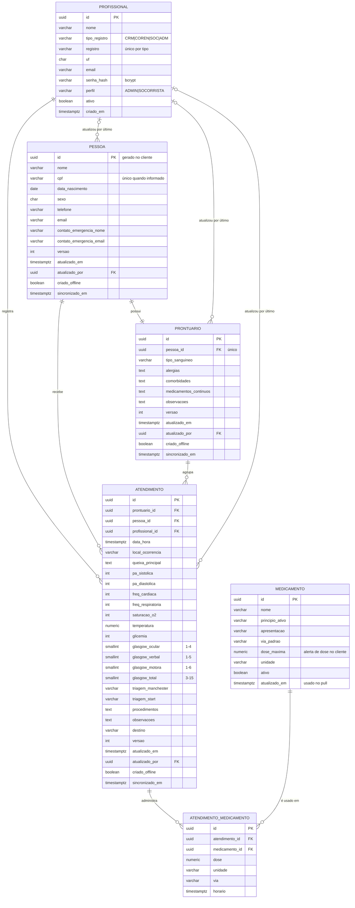

# 3. Modelagem dos Bancos de Dados

O sistema tem **dois bancos**: o **central** (PostgreSQL, na VM) e o **local** (IndexedDB, embarcado no dispositivo). Scripts: `database/01_schema.sql` (estrutura) e `database/02_seed.sql` (dados iniciais).

## 3.1 Banco central — PostgreSQL

`atendimento.profissional_id` é quem **registrou** o atendimento (o usuário do token, nunca o valor enviado no corpo). `atualizado_por`, em pessoa, prontuário e atendimento, é quem fez a **última alteração**; o histórico completo de quem alterou o quê fica em `auditoria_alteracao`.

Tabelas de suporte (sem chave estrangeira, para nunca bloquear o registro de log/auditoria):

| Tabela | Finalidade | Colunas principais |
|---|---|---|
| `sync_operacao` | **Idempotência**: cada `opId` processado | `op_id` (PK), `entidade`, `entidade_id`, `profissional_id`, `dispositivo_id`, `resultado` (CRIADO/ATUALIZADO/SEM_ALTERACAO/CONFLITO_RESOLVIDO/VINCULADO), `estrategia`, `recebido_em` |
| `registro_vinculado` | **Cadastro duplicado** entre dispositivos offline (ver 02_API, seção 2.5) | `entidade`, `id_origem` (id do dispositivo), `id_destino` (registro existente), `profissional_id`, `dispositivo_id`, `criado_em` |
| `auditoria_alteracao` | **Rastreabilidade** de dados | `data_hora`, `entidade`, `entidade_id`, `operacao` (INSERT/UPDATE/CONFLITO/VINCULO/INATIVACAO/UPDATE_SENHA), `origem` (API_DIRETA/SYNC_PUSH/PORTAL), `estrategia`, `profissional_id`, `dispositivo_id`, `op_id`, `dados_antes` (JSONB), `dados_depois` (JSONB) |
| `log_acesso` | **Logs de acesso** de todos os serviços + logs offline do cliente | `servico`, `origem` (SERVIDOR/CLIENTE_OFFLINE), `data_hora`, `ip_cliente`, `profissional_id`, `registro`, `metodo`, `rota`, `status_code`, `tempo_ms`, `dispositivo_id`, `id_local` (único) |

### Colunas de controle de sincronização

| Coluna | Uso |
|---|---|
| `id` (UUID) | Gerado **no dispositivo**, inclusive offline. É a chave natural do upsert: reenvio nunca cria outro registro. |
| `versao` | Controle otimista de concorrência. O cliente envia a versão em que se baseou; se for diferente da atual, há conflito. |
| `atualizado_em` | Carimbo de data/hora da edição feita pelo profissional (critério do LWW). |
| `sincronizado_em` | Quando o registro chegou/mudou no servidor (critério do pull incremental). |
| `criado_offline` | Indica que o registro nasceu no modo offline (exibido no portal e no PDF). |

## 3.2 Banco local — IndexedDB (Dexie) no dispositivo

Definido em `client-app/src/db/localDb.js`. Os registros clínicos têm os mesmos campos do servidor (em camelCase) mais `syncStatus`.

| Store (tabela) | Chave / índices | Conteúdo |
|---|---|---|
| `pessoas` | `id`, `nome`, `cpf`, `syncStatus` | Pessoas recebidas do servidor ou criadas no dispositivo |
| `prontuarios` | `id`, `pessoaId`, `syncStatus` | Prontuários |
| `atendimentos` | `id`, `pessoaId`, `prontuarioId`, `dataHora`, `syncStatus` | Atendimentos com a lista `medicamentos` embutida |
| `medicamentos` | `id`, `nome` | Cadastro de apoio (somente leitura no cliente; inativados são ocultados) |
| `outbox` | `++seq`, `opId`, `[entidade+entidadeId]`, `status` | Fila de comandos a enviar: `{seq, opId, entidade, entidadeId, dados, criadoEm, status, mensagem}` |
| `logs` | `id`, `dataHora`, `enviado` | Operações feitas offline (enviadas via `POST /log`) |
| `historico` | `++id`, `dataHora` | Resultado de cada sincronização (conflitos, duplicados, erros) |
| `meta` | `chave` | `ultimoPull` (marca d'água do pull incremental) e `profissionalId` (dono dos dados do aparelho) |

**Sessão e logout.** A sessão local (`localStorage`) libera o app até o profissional sair, mesmo com o token vencido: offline ninguém é bloqueado. O token só é exigido para sincronizar; se venceu, o app pede a senha de novo e envia a Outbox. Ao **sair**, todas as stores acima são apagadas, para que o próximo profissional não veja os pacientes do anterior. Por isso a saída é bloqueada enquanto houver registros ou logs não enviados, e um aparelho com dados pendentes de um profissional não aceita o login de outro.

`syncStatus`: `PENDENTE` (há comando na Outbox), `SINCRONIZADO` (confirmado pelo servidor), `ERRO` (servidor recusou; o comando fica na Outbox com a mensagem).

## 3.3 Dados iniciais (seed)

| Tipo | Registro | Senha | Perfil |
|---|---|---|---|
| ADM | `admin` | `senha123` | ADMIN (portal) |
| CRM | `12345` | `senha123` | SOCORRISTA |
| COREN | `54321` | `senha123` | SOCORRISTA |
| SOC | `SOC-0001` | `senha123` | SOCORRISTA |

Além desses, o seed traz 3 profissionais de exemplo (um deles **inativo**, para mostrar que inativado não faz login), totalizando 7, além de 11 medicamentos, 6 pessoas, cada uma com seu prontuário, e 6 atendimentos já sincronizados, em horários variados. O passo 9 do roteiro usa `database/03_novos_medicamentos.sql` (Morfina, Naloxona, Hidrocortisona), que eleva o total para 14 medicamentos. Os mesmos cadastros também podem ser feitos pelo portal (menu **Cadastros**).
